# TAŞKIN — Urban Flood Level Monitoring System

<div align="center">

> 🇬🇧 **English** | [🇹🇷 Türkçe için tıklayın → README_TR.md](README_TR.md)


**Low-cost, wireless sensor network for real-time urban stormwater level monitoring and flood risk indexing.**

</div>

---

## 1. Project Title

**TAŞKIN: Low-Cost Data Collection and Planning Support System for Urban Stormwater Channels**
*(Kentsel Yağmur Suyu Hatları İçin Düşük Maliyetli Veri Toplama ve Planlama Destek Sistemi)*

---

## 2. Project Overview

### Problem

Urban stormwater drainage systems in cities like Adana, Turkey fail silently. Surface flooding recurs at the same intersections and underpasses after every storm, yet municipalities have **no continuous, local-scale water level data** to prioritize infrastructure repairs. Flood risk management relies on post-incident reports rather than sensor evidence.

### What This System Does

TAŞKIN deploys a multi-node wireless sensor network that continuously measures water fill level (as a percentage of channel depth) at multiple urban measurement points, transmits data wirelessly to a central hub, logs it to an SD card, and streams it live to a map-based web dashboard.

The system's key output is not raw sensor readings — it produces a **TAŞKIN Risk Index (TRİ)**, a composite 0–100 score per measurement point derived from five risk parameters:
- Mean fill level
- Maximum fill level
- Time spent above the 80% threshold
- 80% threshold crossing count
- Peak fill-rise rate (fastest climb over a 60 s window)

The parameters are combined with a transparent **multi-criteria decision-making (MCDM)** scheme (weighted linear combination, after Malczewski) using a **hybrid normalization**: mean and max are kept on their physical 0–100% scale, the unbounded parameters are min-max normalized, and all five carry equal weight. This transforms collected data into **decision-support output** for infrastructure planning — not just an alarm, but a comparative priority ranking across locations.

### Technical Scope

| Parameter | Value |
|---|---|
| Nodes deployed | 3 |
| Sampling rate | 1 Hz (1 sample/second/node) |
| Wireless protocol | ESP-NOW (no WiFi infrastructure required) |
| Ultrasonic sensor | JSN-SR04T (waterproof); HC-SR04 in early prototype |
| Measurement accuracy | ±1 cm (JSN-SR04T) |
| Lab validation | 7,200 seconds (PVC pipe, controlled) |
| Field test | 10,800 seconds over 3 days, Adana, Feb 2026 |
| Battery runtime (measured) | 10–12 hours @ Always-On mode |

---

## 3. System Architecture

The system has four layers:

```
┌────────────────────────────────────────────────────────────────┐
│                        SENSING LAYER                           │
│                                                                │
│  [Node 1 — Barajyolu]  [Node 2 — Turgut Özal]  [Node 3 — Ref] │
│  ESP32-WROOM-32U        ESP32-WROOM-32U          ESP32-WROOM   │
│  JSN-SR04T              JSN-SR04T                JSN-SR04T     │
│  Li-Po + TP4056 + MT3608                                       │
└────────────────────┬───────────────────────────────────────────┘
                     │ ESP-NOW broadcast
                     │ struct: {node_id, fill_pct, alarm}
                     ▼
┌────────────────────────────────────────────────────────────────┐
│                         HUB LAYER                              │
│              ESP32-S3-N16R8 + SPI SD Card Module               │
│  - Receives and validates ESP-NOW packets                      │
│  - Clamps fill_pct to 0–100, drops malformed packets           │
│  - Logs timestamped CSV to SD card                             │
│  - Outputs comma-delimited lines to USB Serial                 │
└────────────────────┬───────────────────────────────────────────┘
                     │ USB Serial @ 115200 baud
                     │ format: node_id,fill_pct,alarm
                     ▼
┌────────────────────────────────────────────────────────────────┐
│                      BRIDGE LAYER (PC)                         │
│                       server.py (Python)                       │
│  - Reads serial port (auto-detect or --port flag)              │
│  - Parses, validates, and clamps each incoming line            │
│  - Broadcasts JSON over WebSocket (ws://localhost:8765)        │
│  - Serves index.html via HTTP (http://localhost:8080)          │
└────────────────────┬───────────────────────────────────────────┘
                     │ WebSocket JSON stream
                     ▼
┌────────────────────────────────────────────────────────────────┐
│                   VISUALIZATION LAYER                          │
│                       index.html                               │
│  - Leaflet satellite map, color-coded markers per node         │
│  - 60-point sparkline fill history per node                    │
│  - Live log stream, SD write indicator, WS status             │
└────────────────────────────────────────────────────────────────┘
```

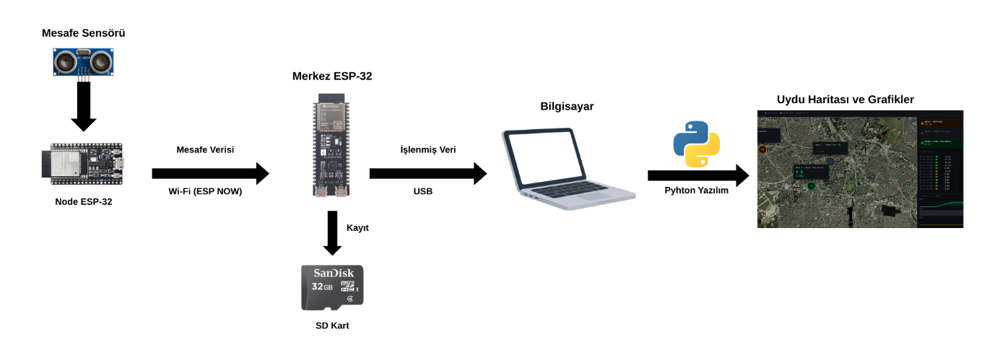

### Data Flow

1. JSN-SR04T measures distance to water surface (median of 5 samples) → converted to fill% via float arithmetic `(depth − distance) / depth × 100`
2. Node broadcasts `{node_id, fill_pct, alarm}` struct via ESP-NOW to broadcast MAC `FF:FF:FF:FF:FF:FF`
3. Hub ESP32-S3 validates (node_id 1–10, fill_pct 0–100), logs to SD, writes to Serial
4. `server.py` parses Serial, broadcasts `{"type":"data", "node_id":N, "doluluk_pct":X, "alarm":Y, "time":"..."}` over WebSocket
5. `index.html` receives JSON, updates map marker color, sparkline, and log table in real time

---

## 4. Hardware Components

### Hub Unit (1×)

| Component | Part | Technical Role |
|---|---|---|
| Microcontroller | ESP32-S3-N16R8 | Receives ESP-NOW, runs SD logging, outputs USB Serial |
| SD card module | SPI Micro SD Module | Interfaces SD card to ESP32-S3 SPI bus |
| Storage | 16 GB Micro SD Card | Stores `/veri_log.csv` continuously |

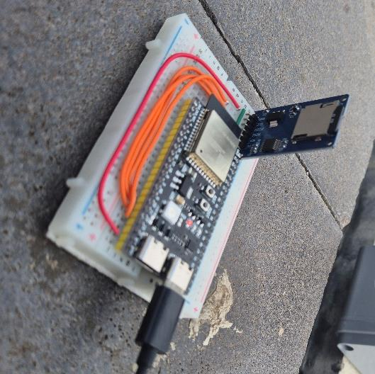

### Sensor Nodes (3×, identical)

| Component | Part | Technical Role |
|---|---|---|
| Microcontroller | ESP32-WROOM-32U | Drives JSN-SR04T, manages ESP-NOW, evaluates alarm |
| Ultrasonic sensor | JSN-SR04T | Waterproof non-contact distance probe (~25–450 cm) |
| Battery | 3.7V 1800 mAh Li-Po | Field power — no mains required |
| Charger | TP4056 module | Li-Po charge management with overcharge protection |
| Boost converter | MT3608 | Steps 3.7V → stable 5V for ESP32 and sensor |
| Antenna | GSM external + IPEX–SMA cable | Extends ESP-NOW range through enclosure wall |
| Enclosure | 11×11×7 cm IP67 thermoplastic box | Weatherproofs electronics for outdoor field use |
| Moisture control | Silica gel sachet | Prevents internal condensation |
| Mounting | Plastic cable ties | Fixes enclosure to structure |

> **Sensor migration:** the initial prototype used the **HC-SR04**. Because its transducer is not weatherproof and produced rain-droplet spikes in the field, the design moved to the waterproof **JSN-SR04T** (current node firmware). Full bill of materials: [`docs/hardware/malzeme_listesi.md`](docs/hardware/malzeme_listesi.md).

### Why ESP-NOW Over WiFi or LoRa?

ESP-NOW is chosen because:
- **No WiFi infrastructure** exists at target locations (street underpasses, drainage inlets)
- **Sub-10ms latency**, adequate for 1 Hz sampling
- **Native to ESP32**, zero additional hardware cost
- **Broadcast mode**: no peer address configuration needed per deployment — any hub receives any node

---

## 5. Physical Design

Each node is enclosed in an **IP67-rated 11×11×7 cm thermoplastic box**. The JSN-SR04T waterproof probe is oriented to point **downward into the drainage channel or road underpass** through a sealed port. The antenna exits through a cable gland to ensure RF propagation outside the enclosure.

Internal layout: ESP32 → perforated PCB board → TP4056 → MT3608 → shared GND bus. Wiring kept short to minimize noise on the ECHO signal line.

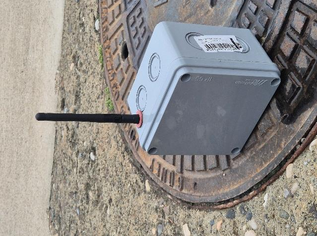

Field stations (left→right: Barajyolu, Turgut Özal, Sinanpaşa reference), each fixed over a stormwater grate:

| Node 1 — Barajyolu | Node 2 — Turgut Özal | Node 3 — Sinanpaşa (Ref.) |
|---|---|---|
| 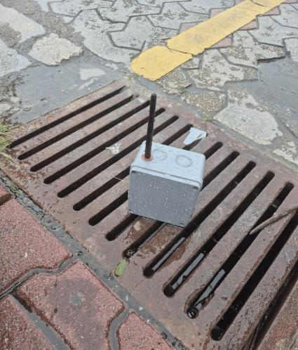 | 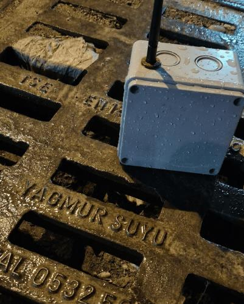 | 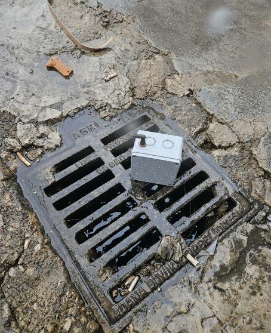 |

---

## 6. Wiring / Connections

### Hub: ESP32-S3 ↔ SD Card Module

| SD Module Pin | ESP32-S3 GPIO | Notes |
|---|---|---|
| GND | GND | Common ground |
| VCC | 5V | Module powered from USB |
| MISO | GPIO 19 | SPI data input |
| MOSI | GPIO 23 | SPI data output |
| SCK | GPIO 18 | SPI clock |
| CS | GPIO 5 | Chip select (active LOW) |

> **Note:** The firmware initializes the bus explicitly with `SPI.begin(18, 19, 23, 5)`, matching the EK-5.1 wiring diagram.

### Node: ESP32 ↔ JSN-SR04T ↔ Power Chain

| Signal | From | To | Notes |
|---|---|---|---|
| TRIG | GPIO 5 | JSN-SR04T TRIG | 10 µs HIGH pulse initiates measurement |
| ECHO | JSN-SR04T ECHO | GPIO 18 (via voltage divider) | At 5V supply ECHO is 5V logic — divider to 3.3V recommended |
| VCC (sensor) | MT3608 5V out | JSN-SR04T VCC | Sensor requires 5V supply |
| VCC (ESP32) | MT3608 5V out | ESP32 VIN | Same 5V rail |
| GND | Common bus | All components | Single shared ground |
| BAT+ | Li-Po (+) | TP4056 B+ | Charge input |
| OUT+ | TP4056 OUT+ | MT3608 VIN+ | Regulated charge to boost converter |

**Alarm reset button:** GPIO 25 (`INPUT_PULLUP`). Reads LOW during loop → zeros alarm flag for that cycle.

**Hub — ESP32-S3 ↔ SD module:**

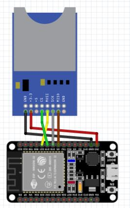

> Pins match the firmware (`SPI.begin(18, 19, 23, 5)`); full table in [`docs/hardware/baglanti_semasi.md`](docs/hardware/baglanti_semasi.md).

**Node — ESP32 ↔ ultrasonic sensor ↔ power chain** (diagram shows the HC-SR04 prototype; JSN-SR04T uses the same TRIG/ECHO pins):

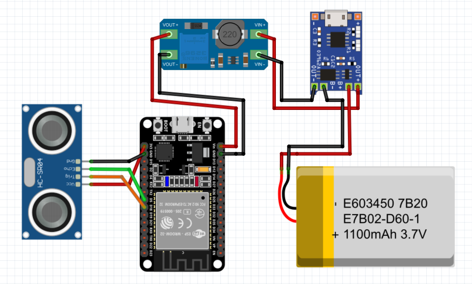

> Full pin tables: [`docs/hardware/baglanti_semasi.md`](docs/hardware/baglanti_semasi.md)

---

## 7. Software Structure

```
Taskin_2204-D/
├── firmware/
│   ├── node/
│   │   └── node.ino             # Sensor node firmware (ESP32-WROOM, JSN-SR04T)
│   └── merkez/
│       └── merkez.ino           # Hub firmware (ESP32-S3, SD recovery)
├── software/
│   ├── server.py                # Python serial → WebSocket bridge
│   └── index.html               # Single-file web dashboard
├── analysis/
│   └── tri_score.py             # TRİ calculator (min-max + hybrid)
├── data/
│   ├── samples/                 # Field test CSV logs (4 files, ~10,800 rows each)
│   └── session_log.md           # Field session metadata
├── docs/
│   ├── hardware/
│   │   ├── baglanti_semasi.md   # Pin connection tables
│   │   └── malzeme_listesi.md   # Bill of materials (sensor included)
│   └── images/                  # Field photos, circuit visuals
├── LICENSE
├── requirements.txt
└── README.md / README_TR.md
```

### `node.ino` — Sensor Node

- Configures JSN-SR04T pins, alarm reset button (PULLUP), and ESP-NOW broadcast peer (`FF:FF:FF:FF:FF:FF`)
- `tekOlcum()` / `mesafeOlc()`: takes 5 samples (150 ms echo timeout), rejects out-of-range readings, returns the **median** to suppress noise
- `loop()`: measure → float fill% (no `map()`) → on failed read holds last valid value → evaluate alarm → `esp_now_send()` → 1000 ms delay
- Button on GPIO 25: if LOW during loop, sets `alarm = 0` for that cycle

### `merkez.ino` — Hub

- SPI bus init: `SPI.begin(18, 19, 23, 5)` (SCK, MISO, MOSI, CS) — matches the EK-5.1 wiring diagram
- Creates `/veri_log.csv` with header row on first boot
- **SD recovery:** if a write fails or the card drops, `sdKurtarmaDene()` re-initializes the card (cooldown-limited) and retries; emits `SD_FAIL,node_id` while degraded and `SD_RECOVERED` on reconnect
- `OnDataRecv()` callback: validates node_id ∈ [1,10], clamps fill to [0,100], validates alarm ∈ {0,1}
- Logs `zaman_ms,node_id,doluluk,alarm` to SD; prints `node_id,fill_pct,alarm` to Serial
- Prints `SD_OK,node_id` after each successful SD write (consumed by `server.py`)

### `server.py` — Bridge

- `find_esp_port()`: auto-detects ESP32 by "cp210", "ch340", "uart", "esp" in port description
- `serial_reader()`: async coroutine reading Serial lines in thread executor
- Parses `SD_OK,N` → broadcasts `{"type":"sd_log"}` JSON
- Parses `id,pct,alarm` → validates (node_id 1–10, pct −10 to 200) → clamps [0,100] → broadcasts `{"type":"data"}` JSON
- HTTP server on port 8080 serves `index.html` from script directory
- Reconnects to Serial after disconnect with 3-second retry loop

### `index.html` — Dashboard

- Leaflet + ESRI satellite tiles; centered on Adana (37.0°N, 35.32°E)
- Custom colored markers per node: green (<50%), orange (50–80%), red (>80%)
- Hover tooltip with per-node sparkline chart
- Right panel: 3 node cards with fill%, last-packet age, alarm badge
- 60-point rolling sparklines; WebSocket auto-reconnects on disconnect

### `analysis/tri_score.py` — TRİ Calculator

- Reads all CSVs from `data/samples/`; drops `durum=KAYIP` sensor-dropout rows
- Computes the five risk parameters per node: mean fill (O), max fill (M), seconds above 80% (E), 80%-crossing count (F), and peak fill-rise rate (A, %/min over a 60 s window)
- Combines them into the composite TRİ using a **hybrid normalization** (MCDM weighted-combination, see §10): O and M are already on a physical 0–100% scale so they are used directly, while E, F and A are min-max normalized across nodes; all five carry equal weight (0.20)
- Run with: `python analysis/tri_score.py` (`--chart` saves the time-series PNG; `--method minmax` shows the initial pure-min-max variant used in the sensitivity analysis)

---

## 8. Installation & Setup

### 8.1 Arduino Firmware

**Tested environment:**
- Arduino IDE 2.3.x
- ESP32 board package: `esp32 by Espressif Systems v3.x`
- OS: Windows 11

**Board package install:**
- *File → Preferences → Additional Boards Manager URLs:*
  `https://raw.githubusercontent.com/espressif/arduino-esp32/gh-pages/package_esp32_index.json`
- *Tools → Board Manager* → search "esp32" → install `esp32 by Espressif Systems`

**No external library install required.** All libraries (`WiFi.h`, `esp_now.h`, `SD.h`, `SPI.h`) are included with the ESP32 board package.

**Node firmware upload:**
1. Open `firmware/node/node.ino`
2. Set per-device constants:
   ```cpp
   #define NODE_ID              1    // Unique 1–10 per device
   #define TANK_YUKSEKLIK_CM  100    // Channel depth in cm
   #define ALARM_THRESHOLD     80    // Alarm threshold (%)
   ```
3. *Tools → Board* → **ESP32 Dev Module**
4. *Tools → Port* → select device COM port
5. Upload

**Hub firmware upload:**
1. Open `firmware/merkez/merkez.ino`
2. Insert formatted SD card into module
3. *Tools → Board* → **ESP32S3 Dev Module**
4. Upload

### 8.2 Python Bridge

```bash
# Python 3.8+ required
pip install -r requirements.txt

# Auto-detect ESP32 port:
python software/server.py

# Specify port manually:
python software/server.py --port COM12
python software/server.py --port /dev/ttyUSB0
```

### 8.3 Dashboard

While `server.py` is running:
```
http://127.0.0.1:8080/index.html
```
No build step. No npm. Single HTML file.

---

## 9. Usage

### Startup Sequence

1. Power all sensor nodes (battery or USB)
2. Connect hub ESP32-S3 to PC via USB
3. `python software/server.py --port COM12`
4. Open `http://127.0.0.1:8080/index.html`
5. Nodes appear on map within ~5 seconds as ESP-NOW packets arrive

### Runtime Behavior

- Map markers update color in real time: green / orange / red
- SD indicator (top bar) flashes green on each SD write confirmation
- Log stream appends every incoming packet with timestamp and node color
- Sparklines scroll with newest data on the right

### SD Card Data

After session, eject SD card. File `/veri_log.csv` contains:
```
zaman_ms,node_id,doluluk,alarm
12500,1,63.5,0
13510,2,81.2,1
```
**Note:** `zaman_ms` is milliseconds since hub boot — not wall clock time. Correlate with session start time from `server.py` terminal output for absolute timestamps.

---

## 10. Test Results

### Laboratory Validation

**Setup:** 100 cm-deep PVC pipe, water raised and lowered over 2 hours. 7,200 samples per node.

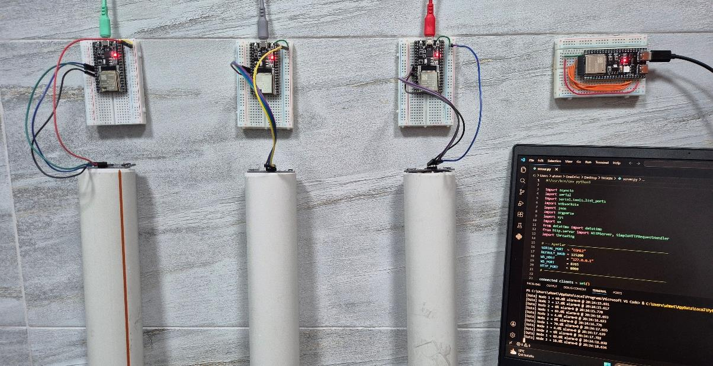

**Sensor accuracy:** ±4 cm from manual reference during the early **HC-SR04 prototype** lab run; the production **JSN-SR04T** improved this to ~±1 cm and removed rain-droplet spikes.

| Node | Mean Fill (%) | Max Fill (%) | Time >60% (s) | Time >80% (s) | Rise 20→80% (s) |
|---|---|---|---|---|---|
| Node 1 — Barajyolu | 51 | 92 | 318 | 102 | 19 |
| Node 2 — Turgut Özal | 36 | 74 | 124 | 39 | 26 |
| Node 3 — Sinanpaşa (Ref.) | 15 | 29 | 0 | 0 | — |

Zero packet loss during 2-hour lab session. Serial reconnection after simulated disconnect: <3 seconds.

### Field Test — Adana, Feb 9–11, 2026

**Conditions:** Real urban drainage locations; rainfall 1.5–9.5 mm/session.

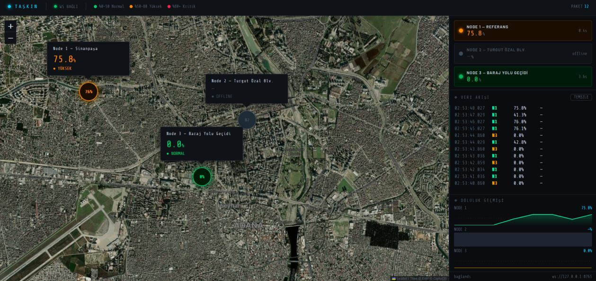

| Date | Node | Location | Rainfall |
|---|---|---|---|
| Feb 9 AM | Node 1 | Seyhan — Barajyolu Alt Geçidi | ~1.5 mm |
| Feb 9 PM | Node 1 | Seyhan — Barajyolu Alt Geçidi | ~4.2 mm |
| Feb 10 | Node 2 | Çukurova — Turgut Özal Blv. | ~5.8 mm |
| Feb 11 | Node 3 | Yüreğir — Sinanpaşa (Ref.) | ~9.5 mm |

The five TRİ parameters per node (O mean, M max, E seconds above 80%, F 80%-crossings, A peak rise-rate), computed by `analysis/tri_score.py` on `data/samples/`:

| Node | O mean (%) | M max (%) | StdDev | E >80% (s) | F crossings | A rise (%/min) |
|---|---|---|---|---|---|---|
| Node 1 — Barajyolu | 62 | 94 | 11.4 | 168 | 7 | 39 |
| Node 2 — Turgut Özal | 43 | 82 | 8.4 | 54 | 3 | 19 |
| Node 3 — Sinanpaşa (Ref.) | 18 | 29 | 5.9 | 0 | 0 | 4 |

Barajyolu is not just the highest-mean node — it also has the highest variance, the most 80% crossings, and a rise rate ~82% faster than Turgut Özal.

**TRİ Scores** (hybrid normalization, equal weights — output of `analysis/tri_score.py`):

| Node | TRİ | Risk |
|---|---|---|
| Node 1 — Barajyolu | **91** | 🔴 Critical |
| Node 2 — Turgut Özal | **49** | 🟡 Medium |
| Node 3 — Sinanpaşa (Ref.) | **9** | 🟢 Low |

> **Methodology & sensitivity (AR-GE).** The three points fall into three distinct risk classes. We first normalized every parameter with min-max, but a single normalization is ill-suited to mean and max (already on a physical 0–100% scale), so we moved to the hybrid scheme above. A sensitivity check confirms robustness: under pure min-max (`--method minmax`) the scores shift but Barajyolu stays the clear #1 and the overall ranking is unchanged — which is why the equal-weight choice is defensible.

Per-node fill over each session (regenerate with `python analysis/tri_score.py --chart`):

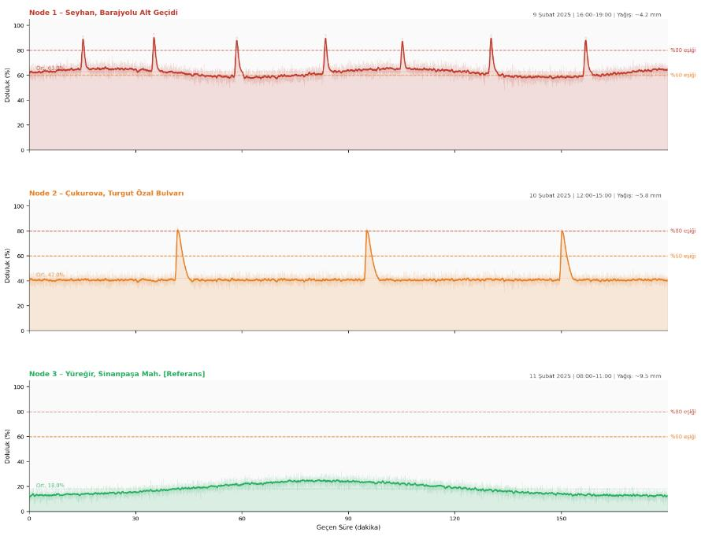

---

## 11. Limitations & Future Improvements

### Battery Life

Field operation was conducted in **Always-On mode** to measure system stability and data continuity.

| Component | State | Current Draw (avg.) |
|---|---|---|
| ESP32-DevKit V4 | Active (WiFi mode on) | ~70-90 mA |
| JSN-SR04T | Continuous measurement | ~15 mA |
| MT3608 Regulator | Loses | ~5-10 mA |
| **Total** | **Always-On** | **~90-115 mA** |

**Measured runtime:** 10–12 hours on 3.7V 1800 mAh Li-Po with MT3608 boost converter, under continuous sampling and logging.

> **Next step:** Deep Sleep optimization (ESP32 light sleep between measurements at 1 Hz) is planned for the next firmware revision. Estimated sleep-mode current: ~10 mA. Projected extended runtime: 60–80 hours.

### Current Weaknesses

| Weakness | Impact |
|---|---|
| Ultrasonic echoes off foam/turbulence | Even with the JSN-SR04T, surface turbulence can scatter echoes (mitigated by 5-sample median) |
| NODE_ID hardcoded per flash | Multiple nodes require separate Arduino upload per device |
| No RTC | CSV timestamps are `millis()` — relative to boot, not wall clock |
| Single-hop ESP-NOW | All nodes must be within ~200 m of hub — no mesh or relay |
| 3-day field test only | No seasonal variability characterized |
| No rain gauge integration | Fill rise rate cannot be correlated with precise precipitation |
| PC required for dashboard | Hub must be USB-connected to a running `server.py` |

### Recommended Improvements

1. Upgrade the JSN-SR04T to a radar / MaxBotix MB7389 sensor for foam/turbulence immunity
2. Add DS3231 RTC module to hub for absolute timestamps
3. Implement ESP32 Deep Sleep with 1 Hz wake cycles for multi-day battery operation
4. Add solar panel + charge controller for permanent field deployment
5. Integrate MGM weather API for precipitation correlation
6. Extend field test to full rainy season (October–March in Adana)
7. Add MQTT/HTTP cloud upload to remove dependency on local PC

---

## 12. Conclusion

TAŞKIN demonstrates that a sub-$10 per-node sensor system can produce statistically differentiated, multi-point fill rate data suitable for infrastructure risk prioritization. The composite TRİ metric enables location ranking across multiple parameters — not just peak fill values.

The system correctly identified Node 1 (Barajyolu underpass) as the highest-risk location across all measured parameters, consistent with known local flooding history. Node 3 (Sinanpaşa, reference) showed stable low fill throughout all sessions, validating the comparative measurement design.

Primary constraint is the 3-day field window. The system's planning value increases proportionally with data duration — a minimum 3-month continuous dataset is required for meaningful trend extraction and infrastructure prioritization recommendations.

---

## License

[MIT License](LICENSE) — Copyright (c) 2026 TAŞKIN Project

---

<div align="center">
<sub>TAŞKIN Project · Adana Pilot Site · 2026</sub>
</div>
