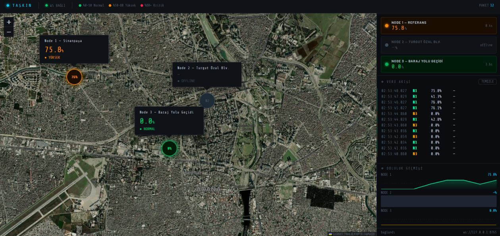

# TAŞKIN — Urban water-level monitoring

[Türkçe](README.md) · [Developer guide (Turkish)](docs/DEVELOPMENT.md)

TAŞKIN is an ESP32 prototype that measures water levels at multiple drainage locations, sends readings over ESP-NOW to an ESP32-S3 hub, logs to SD, and displays a live map through a local Python bridge.



The separate analysis tool combines mean and maximum fill, time at or above 80%, upward threshold crossings and peak 60-second rise rate into a comparative index. Included CSV files yield scores of 91.3 (Barajyolu), 48.6 (Turgut Özal) and 9.4 (Sinanpaşa). These are relative index scores, not flood probabilities. Sessions have different weather and observation periods, limiting direct comparisons.

## Quick start

Use Python 3.12. Create and activate a virtual environment, then run:

```sh
python -m pip install -r requirements.txt
python analysis/tri_score.py
python analysis/tri_score.py --data-dir path/to/csvs --chart --out chart.png
python -m unittest discover -s tests -v
```

For live hardware: `python software/server.py --port COM12` (replace the port), then open http://127.0.0.1:8080/index.html. Without `--port`, recognized USB serial adapters are detected. The map needs internet access and displays nodes 1–3. This repository page is not a hosted live dashboard.

Hub: ESP32-S3; SD SCK=12, MISO=13, MOSI=11, CS=10. These replace incompatible pins in older report drawings. Node: ESP32-WROOM; TRIG=5, ECHO=18, button=25. Use suitable ECHO level conversion to 3.3 V. Measure channel depth and probe offset before changing `TANK_YUKSEKLIK_CM` and `SENSOR_OFFSET_CM`. Invalid readings are not retransmitted as fresh measurements.

See [wiring](docs/hardware/baglanti_semasi.md), [components](docs/hardware/malzeme_listesi.md) and [session metadata](data/session_log.md). Hardware testing is still required after firmware changes. The prototype is not a validated operational flood-warning system. [MIT license](LICENSE).
