# TAŞKIN — Kentsel Su Baskını Seviyesi İzleme Sistemi

<div align="center">

> 🇹🇷 **Türkçe** | [🇬🇧 For English → README.md](README.md)


**Kentsel yağmur suyu hatlarında gerçek zamanlı su seviyesi izleme ve taşkın riski endeksleme sistemi.**

</div>

---

## 1. Proje Başlığı

**TAŞKIN: Kentsel Yağmur Suyu Hatları İçin Düşük Maliyetli Veri Toplama ve Planlama Destek Sistemi**

---

## 2. Projenin Özeti ve Önemi

### Problem

Adana gibi şehirlerde kentsel yağmur suyu drenaj sistemleri sessizce çökmektedir. Aynı kavşaklarda ve alt geçitlerde yağmur sonrası su taşkınları tekrarlamakta; ancak belediyelerin elinde bu tehlikeli noktaları önceliklendirmek için **sürekli ve yerel ölçekte su seviyesi verisi bulunmamaktadır.** Taşkın risk yönetimi, sensör kanıtına değil olay sonrası raporlamaya dayanmaktadır.

### Sistemin İşlevi

TAŞKIN, birden fazla kentsel ölçüm noktasında su doluluk düzeyini sürekli ölçen, verileri kablosuz olarak merkez birime aktaran, SD karta kaydeden ve web tabanlı bir harita arayüzüne canlı olarak yayınlayan çok düğümlü bir sensör ağıdır.

Sistemin temel çıktısı ham sensör okumaları değil; her ölçüm noktası için beş risk parametresinden hesaplanan **TAŞKIN Risk İndeksi (TRİ)** modelidir:
- Ortalama doluluk seviyesi
- Maksimum doluluk seviyesi
- %80 eşiğinin üzerinde kalınan süre
- %80 eşik aşım sayısı
- Tepe doluluk artış hızı (60 sn pencerede en hızlı tırmanış)

Parametreler, şeffaf bir **çok kriterli karar verme (MCDM)** yaklaşımıyla (Malczewski'nin ağırlıklı doğrusal birleştirme çerçevesi) **karma normalizasyon** kullanılarak birleştirilir: ortalama ve maksimum fiziksel 0–100% ölçeğinde tutulur, sınırsız parametreler min-maks normalize edilir ve beşi de eşit ağırlık taşır. Böylece ham veri, altyapı planlaması için bir **karar destek çıktısına** dönüşür — yalnızca alarm değil, noktalar arası karşılaştırmalı bir öncelik sıralaması.

### Teknik Kapsam

| Parametre | Değer |
|---|---|
| Aktif düğüm sayısı | 3 |
| Örnekleme hızı | 1 Hz (1 ölçüm/saniye/düğüm) |
| Kablosuz protokol | ESP-NOW (WiFi altyapısı gerektirmez) |
| Ultrasonik sensör | JSN-SR04T (su geçirmez); ilk prototipte HC-SR04 |
| Ölçüm doğruluğu | ±1 cm (JSN-SR04T) |
| Laboratuvar testi | 7.200 saniye (PVC boru, kontrollü ortam) |
| Saha testi | 10.800 saniye, Adana, Şubat 2026 |
| Batarya ömrü (ölçülen) | Sürekli-Açık modda 10–12 saat |

---

## 3. Sistem Mimarisi

Sistem dört katmandan oluşmaktadır:

```
┌────────────────────────────────────────────────────────────────┐
│                      SENSÖR KATMANI                            │
│                                                                │
│  [Düğüm 1 — Barajyolu] [Düğüm 2 — Turgut Özal] [Düğüm 3 — Ref]│
│   ESP32-WROOM-32U        ESP32-WROOM-32U         ESP32-WROOM   │
│   JSN-SR04T              JSN-SR04T               JSN-SR04T     │
│   Li-Po + TP4056 + MT3608                                      │
└────────────────────┬───────────────────────────────────────────┘
                     │ ESP-NOW yayın (broadcast)
                     │ paket: {node_id, doluluk_pct, alarm}
                     ▼
┌────────────────────────────────────────────────────────────────┐
│                      MERKEZ KATMANI                            │
│           ESP32-S3-N16R8 + SPI SD Kart Modülü                  │
│  - ESP-NOW paketlerini alır ve doğrular                        │
│  - Doluluk değerini 0–100 aralığına kısıtlar                  │
│  - SD karta zaman damgalı CSV kaydeder                         │
│  - USB Seri porta virgülle ayrılmış satır yazar               │
└────────────────────┬───────────────────────────────────────────┘
                     │ USB Seri @ 115200 baud
                     │ biçim: node_id,doluluk_pct,alarm
                     ▼
┌────────────────────────────────────────────────────────────────┐
│                    KÖPRÜ KATMANI (Bilgisayar)                  │
│                       server.py (Python)                       │
│  - Seri portu okur (otomatik algılama veya --port bayrağı)     │
│  - Her satırı ayrıştırır, doğrular ve kısıtlar                │
│  - WebSocket üzerinden JSON paket yayınlar (ws://localhost:8765)│
│  - index.html'yi HTTP ile sunar (http://localhost:8080)        │
└────────────────────┬───────────────────────────────────────────┘
                     │ WebSocket JSON akışı
                     ▼
┌────────────────────────────────────────────────────────────────┐
│                  GÖRSELLEŞTİRME KATMANI                       │
│                       index.html                               │
│  - Leaflet uydu haritası, renk kodlu düğüm işaretçileri        │
│  - Düğüm başına 60 noktalı kıvılcım grafik (sparkline)         │
│  - Canlı olay akışı, SD göstergesi, WebSocket bağlantı durumu │
└────────────────────────────────────────────────────────────────┘
```

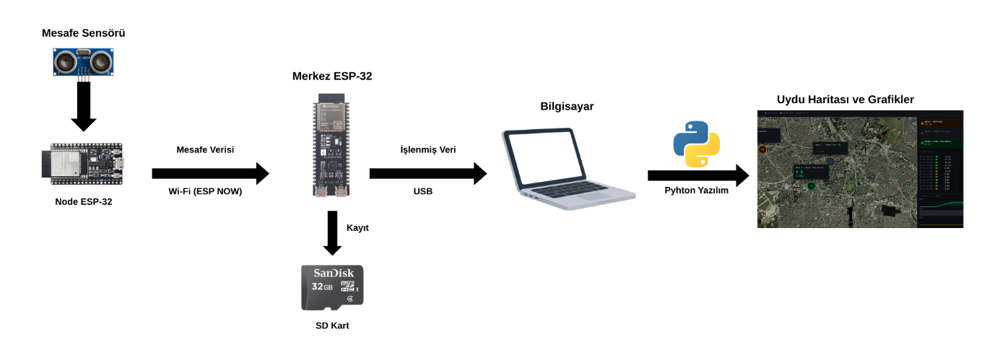

### Veri Akışı

1. JSN-SR04T, su yüzeyine olan mesafeyi ölçer (5 ölçümün medyanı) → float aritmetiğiyle `(derinlik − mesafe) / derinlik × 100` doluluk %'ye dönüştürülür
2. Düğüm, `{node_id, doluluk_pct, alarm}` yapısını ESP-NOW broadcast MAC `FF:FF:FF:FF:FF:FF` adresine gönderir
3. Merkez ESP32-S3, paketi doğrular (node_id 1–10, doluluk 0–100), SD'ye kaydeder, Seri porta yazar
4. `server.py`, Seri portu okur ve WebSocket üzerinden JSON paketi yayınlar
5. `index.html`, JSON'u alır, harita işaretçisinin rengini, kıvılcım grafiğini ve log tablosunu günceller

---

## 4. Donanım Bileşenleri

### Merkez Birim (1 adet)

| Bileşen | Model | Teknik Görev |
|---|---|---|
| Mikrodenetleyici | ESP32-S3-N16R8 | ESP-NOW alım, SD kaydı, USB Seri çıkış |
| SD Kart Modülü | SPI Micro SD Modülü | SD kartı ESP32-S3 SPI veri yoluna bağlar |
| Depolama | 16 GB Micro SD Kart | `/veri_log.csv` dosyasını sürekli tutar |

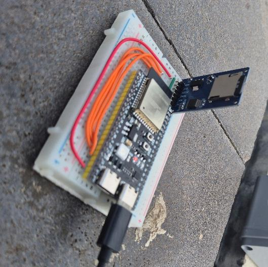

### Sensör Düğümleri (3 adet, özdeş)

| Bileşen | Model | Teknik Görev |
|---|---|---|
| Mikrodenetleyici | ESP32-WROOM-32U | JSN-SR04T sürücüsü, ESP-NOW, alarm yönetimi |
| Ultrasonik Sensör | JSN-SR04T | Su geçirmez temassız mesafe probu (~25–450 cm) |
| Batarya | 3,7V 1800 mAh Li-Po | Şebeke bağlantısı gerektirmeyen saha güç kaynağı |
| Şarj Modülü | TP4056 | Aşırı şarja karşı korumalı Li-Po şarj yönetimi |
| Gerilim Yükseltici | MT3608 | 3,7V → 5V kararlı çıkış (ESP32 ve sensör için) |
| Anten | GSM Harici + IPEX–SMA Kablo | ESP-NOW menzilini kutu dışına taşır |
| Muhafaza | 11×11×7 cm IP67 Termoplastik Buat | Elektroniği dış ortam koşullarına karşı korur |
| Nem Kontrolü | Silica Jel | Kutu içi yoğuşmayı önler |
| Montaj | Plastik Kelepçe | Muhafazayı yapıya sabitler |

> **Sensör geçişi:** İlk prototipte **HC-SR04** kullanıldı. Sensör gövdesi su geçirmez olmadığı ve sahada yağmur damlacığı kaynaklı sıçramalar ürettiği için tasarım su geçirmez **JSN-SR04T**'ye taşındı (güncel düğüm firmware'i). Tam malzeme listesi: [`docs/hardware/malzeme_listesi.md`](docs/hardware/malzeme_listesi.md).

### Neden ESP-NOW?

- Hedef konumlarda (alt geçitler, drenaj ızgaraları) **WiFi altyapısı yoktur**
- **10 ms altı gecikme** — 1 Hz örnekleme için yeterlidir
- **ESP32'ye yerel**: ek donanım maliyeti yoktur
- **Yayın modu**: merkez, istasyon MAC adresi yapılandırması gerektirmeden tüm düğümlerden veri alır

---

## 5. Fiziksel Tasarım

Her düğüm **IP67 sertifikalı 11×11×7 cm termoplastik buat** içine yerleştirilmiştir. JSN-SR04T su geçirmez probu, drenaj kanalına veya alt geçide **yukarıdan aşağı bakacak biçimde** ayarlanmıştır. Anten, RF sinyalinin kutunun dışına taşınmasını sağlamak için kablo rakoru ile dışarı çıkarılmıştır.

İç düzen: ESP32 → delikli plaket → TP4056 → MT3608 → ortak GND barası. ECHO sinyal kablosu kısa tutulmuştur.

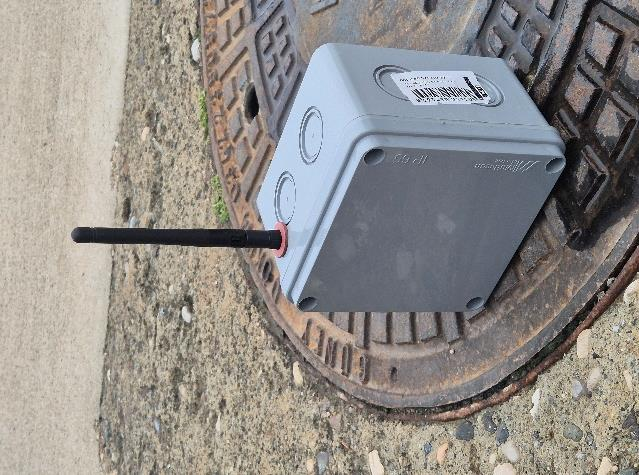

Saha istasyonları (soldan sağa: Barajyolu, Turgut Özal, Sinanpaşa referans), her biri bir yağmur suyu ızgarasının üzerine sabitlenmiş:

| Düğüm 1 — Barajyolu | Düğüm 2 — Turgut Özal | Düğüm 3 — Sinanpaşa (Ref.) |
|---|---|---|
| 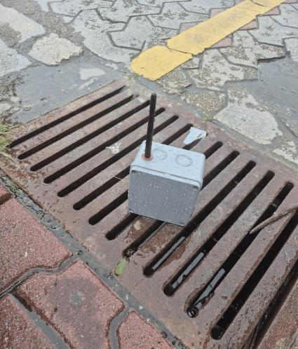 | 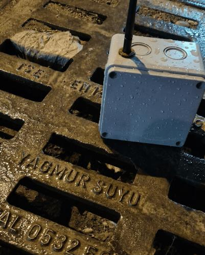 | 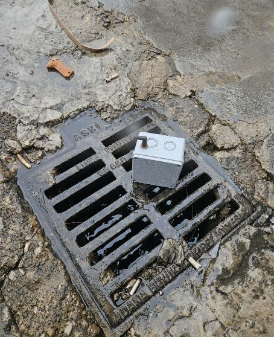 |

---

## 6. Kablolama ve Bağlantılar

### Merkez: ESP32-S3 ↔ SD Kart Modülü

| SD Modül Pini | ESP32-S3 GPIO | Not |
|---|---|---|
| GND | GND | Ortak toprak |
| VCC | 5V | USB'den güç |
| MISO | GPIO 13 | SPI veri girişi |
| MOSI | GPIO 11 | SPI veri çıkışı |
| SCK | GPIO 12 | SPI saat sinyali |
| CS | GPIO 10 | Chip Select (aktif-düşük) |

> **Not:** ESP32-S3 varsayılan SPI pinleri farklıdır. Firmware `SPI.begin(12, 13, 11, 10)` ile özel pin ataması yapar.

### Düğüm: ESP32 ↔ JSN-SR04T ↔ Güç Zinciri

| Sinyal | Kaynak | Hedef | Not |
|---|---|---|---|
| TRIG | GPIO 5 | JSN-SR04T TRIG | 10 µs HIGH darbe ölçümü başlatır |
| ECHO | JSN-SR04T ECHO | GPIO 18 (gerilim bölücü üzerinden) | 5V beslemede ECHO 5V olabilir — bölücü ile 3,3V'a düşürülmesi önerilir |
| VCC (sensör) | MT3608 5V çıkış | JSN-SR04T VCC | Sensör 5V gerektirir |
| VCC (ESP32) | MT3608 5V çıkış | ESP32 VIN | Aynı 5V hattı |
| GND | Ortak bara | Tüm bileşenler | Tek ortak toprak |
| BAT+ | Li-Po (+) | TP4056 B+ | Şarj girişi |
| OUT+ | TP4056 OUT+ | MT3608 VIN+ | Düzenlenmiş şarj çıkışı |

**Alarm sıfırlama düğmesi:** GPIO 25 (`INPUT_PULLUP`). Döngüde LOW okunursa o çevrimde alarm bayrağı sıfırlanır.

**Merkez — ESP32-S3 ↔ SD modülü:**

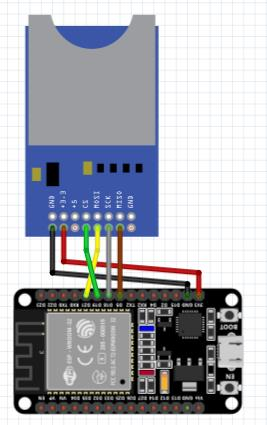

> Yukarıdaki Fritzing şeması varsayılan VSPI pinlerini gösterir; çalışan firmware **SPI veri yolunu GPIO 12/13/11/10'a yeniden atar** (`SPI.begin(12, 13, 11, 10)`). Bağlantıyı [`docs/hardware/baglanti_semasi.md`](docs/hardware/baglanti_semasi.md) tablosuna göre yapın.

**Düğüm — ESP32 ↔ ultrasonik sensör ↔ güç zinciri** (şema HC-SR04 prototipini gösterir; JSN-SR04T aynı TRIG/ECHO pinlerini kullanır):

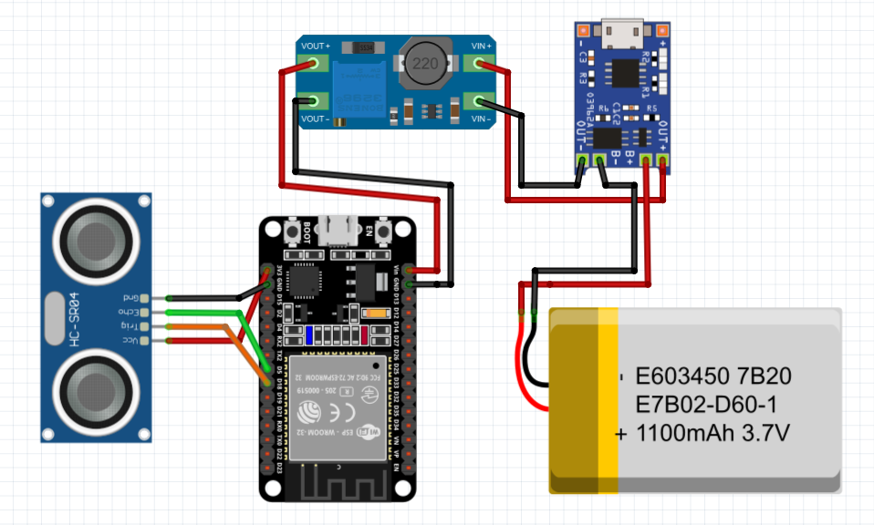

> Tam pin tabloları: [`docs/hardware/baglanti_semasi.md`](docs/hardware/baglanti_semasi.md)

---

## 7. Yazılım Yapısı

```
Taskin_2204-D/
├── firmware/
│   ├── node/
│   │   └── node.ino             # Sensör düğümü firmware (ESP32-WROOM, JSN-SR04T)
│   └── merkez/
│       └── merkez.ino           # Merkez birim firmware (ESP32-S3, SD kurtarma)
├── software/
│   ├── server.py                # Python seri port → WebSocket köprüsü
│   └── index.html               # Tek dosya web panosu
├── analysis/
│   └── tri_score.py             # TRİ hesaplayıcı (MCDM, karma normalizasyon)
├── data/
│   ├── samples/                 # Saha testi CSV kayıtları (4 dosya)
│   └── session_log.md           # Saha oturumu meta verisi
├── docs/
│   ├── hardware/
│   │   ├── baglanti_semasi.md   # Pin bağlantı tabloları
│   │   └── malzeme_listesi.md   # Malzeme listesi (sensör dahil)
│   └── images/                  # Saha fotoğrafları, devre görselleri
├── LICENSE
├── requirements.txt
└── README.md / README_TR.md
```

### `node.ino` — Sensör Düğümü

- JSN-SR04T pinleri, alarm sıfırlama düğmesi (PULLUP) ve ESP-NOW broadcast peer'i yapılandırır
- `tekOlcum()` / `mesafeOlc()`: 5 ölçüm alır (150 ms echo zaman aşımı), aralık dışı okumaları eler, gürültüyü bastırmak için **medyan** döndürür
- `loop()`: ölç → float doluluk % (`map()` yok) → başarısız okumada son geçerli değeri korur → alarm değerlendir → `esp_now_send()` → 1000 ms bekle
- GPIO 25 butonu döngüde LOW ise o çevrimde `alarm = 0` atanır

### `merkez.ino` — Merkez Birim

- Özel SPI başlatma: `SPI.begin(12, 13, 11, 10)` — varsayılan dışı pinler zorunludur
- İlk açılışta başlık satırıyla `/veri_log.csv` oluşturur
- **SD kurtarma:** yazma başarısız olursa veya kart düşerse `sdKurtarmaDene()` kartı yeniden başlatır (cooldown'lı) ve tekrar dener; sorunluyken `SD_FAIL,node_id`, geri gelince `SD_RECOVERED` satırı yazar
- `OnDataRecv()` geri çağrısı: node_id [1,10] aralığını, doluluk [0,100] kısıtını, alarm {0,1} geçerliliğini denetler
- SD'ye `zaman_ms,node_id,doluluk,alarm` kaydeder; Seri porta `node_id,doluluk,alarm` yazar
- Başarılı her SD yazımından sonra `SD_OK,node_id` satırı çıkarır

### `server.py` — Köprü

- `find_esp_port()`: "cp210", "ch340", "uart", "esp" anahtar sözcükleriyle ESP32'yi otomatik tespit eder
- `serial_reader()`: thread yürütücüsünde Seri port satırlarını okuyan async coroutine
- `SD_OK,N` satırlarını ayrıştırır → `{"type":"sd_log"}` JSON paketi yayınlar
- `id,pct,alarm` satırlarını ayrıştırır → doğrular → kısıtlar → `{"type":"data"}` JSON paketi yayınlar
- 8080 portunda `index.html`'yi HTTP ile sunar; bağlantı kesilince 3 saniyede yeniden bağlanır

### `index.html` — Web Panosu

- Leaflet + ESRI uydu haritası; Adana merkezi (37,0°K, 35,32°D)
- Renk kodlu özel işaretçiler: yeşil (<%50), turuncu (%50–80), kırmızı (>%80)
- Fareyle üzerine gelindiğinde düğüm başına kıvılcım grafik ipucu
- Sağ panel: 3 düğüm kartı — doluluk %, son paket zamanı, kritik uyarı rozeti
- 60 noktalı kayan kıvılcım grafikler; WebSocket bağlantı kesilince otomatik yeniden bağlanır

### `analysis/tri_score.py` — TRİ Hesaplayıcı

- `data/samples/` içindeki tüm CSV dosyalarını okur; `durum=KAYIP` sensör kesinti satırlarını eler
- Düğüm başına beş risk parametresini hesaplar: ortalama doluluk (O), maksimum doluluk (M), %80 üzeri süre (E, sn), %80 aşım sayısı (F) ve tepe doluluk artış hızı (A, 60 sn pencerede %/dk)
- Bunları **karma normalizasyon** ile bileşik TRİ'ye birleştirir (MCDM ağırlıklı birleştirme, bkz. §10): O ve M zaten fiziksel 0–100% ölçeğinde olduğundan doğrudan kullanılır; E, F ve A düğümler arasında min-maks normalize edilir; beşi de eşit ağırlık (0.20) taşır
- Çalıştırma: `python analysis/tri_score.py` (`--chart` zaman serisi PNG kaydeder; `--method minmax` duyarlılık analizindeki ilk saf min-maks varyantını gösterir)

---

## 8. Kurulum ve Yapılandırma

### 8.1 Arduino Firmware

**Test edilen ortam:**
- Arduino IDE 2.3.x
- ESP32 kart paketi: `esp32 by Espressif Systems v3.x`
- İşletim sistemi: Windows 11

**Kart paketi kurulumu:**
- *Dosya → Tercihler → Ek Kart Yöneticisi URL'leri:*
  `https://raw.githubusercontent.com/espressif/arduino-esp32/gh-pages/package_esp32_index.json`
- *Araçlar → Kart Yöneticisi* → "esp32" ara → `esp32 by Espressif Systems` yükle

**Harici kütüphane kurulumu gerekmez.** `WiFi.h`, `esp_now.h`, `SD.h`, `SPI.h` kütüphanelerinin tamamı ESP32 kart paketiyle birlikte gelir.

**Düğüm firmware yükleme:**
1. `firmware/node/node.ino` dosyasını aç
2. Cihaza özgü sabitleri ayarla:
   ```cpp
   #define NODE_ID              1    // Her cihaz için benzersiz 1–10
   #define TANK_YUKSEKLIK_CM  100    // Kanal derinliği (cm)
   #define ALARM_THRESHOLD     80    // Alarm eşiği (%)
   ```
3. *Araçlar → Kart* → **ESP32 Dev Module**
4. *Araçlar → Port* → ilgili COM portunu seç
5. Yükle

**Merkez firmware yükleme:**
1. `firmware/merkez/merkez.ino` dosyasını aç
2. Formatlanmış SD kartı modüle takılı olduğundan emin ol
3. *Araçlar → Kart* → **ESP32S3 Dev Module**
4. Yükle

### 8.2 Python Köprüsü

```bash
# Python 3.8+ gereklidir
pip install -r requirements.txt

# Portu otomatik algılamayla:
python software/server.py

# Portu elle belirterek:
python software/server.py --port COM12
```

### 8.3 Web Panosu

`server.py` çalışırken tarayıcıda şu adresi aç:
```
http://127.0.0.1:8080/index.html
```
Derleme adımı yoktur. Tek bir HTML dosyasıdır.

---

## 9. Kullanım

### Başlangıç Sırası

1. Tüm sensör düğümlerini güce bağla (batarya veya USB)
2. Merkez ESP32-S3'ü USB ile bilgisayara bağla
3. `python software/server.py --port COM12` komutunu çalıştır
4. `http://127.0.0.1:8080/index.html` adresini tarayıcıda aç
5. ESP-NOW paketleri gelmeye başladıkça düğümler haritada ~5 saniye içinde görünür

### Çalışma Zamanı Davranışı

- Harita işaretçileri gerçek zamanlı renk değiştirir: yeşil / turuncu / kırmızı
- SD göstergesi (üst çubuk) her SD yazımında yeşil yanıp söner
- Olay akışı her gelen paketi zaman damgası ve düğüm rengiyle ekler
- Kıvılcım grafikler en yeni veriye göre sağa kayar

### SD Kart Verisi

Oturum sonrasında SD kart çıkarılır. `/veri_log.csv` dosyası şu biçimi içerir:
```
zaman_ms,node_id,doluluk,alarm
12500,1,63.5,0
13510,2,81.2,1
```
**Not:** `zaman_ms`, duvar saatini değil önyüklemeden geçen süreyi (ms) gösterir. Mutlak saatlerle eşleştirmek için `server.py` terminal çıktısındaki oturum başlangıç zamanını referans al.

---

## 10. Test Sonuçları

### Laboratuvar Doğrulaması

**Düzenek:** 100 cm derinliğinde PVC boru, 2 saat boyunca su seviyesi kademeli artırılıp düşürüldü. Düğüm başına 7.200 örnek.

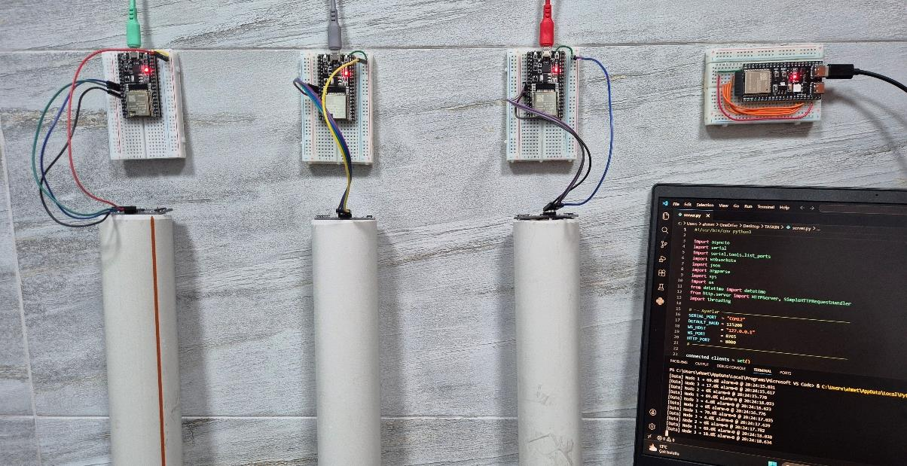

**Sensör doğruluğu:** İlk **HC-SR04 prototip** laboratuvar oturumunda manuel referansa göre ±4 cm sapma ölçüldü; üretim **JSN-SR04T** bunu ~±1 cm'ye iyileştirdi ve yağmur damlacığı sıçramalarını giderdi.

| Düğüm | Ort. Doluluk (%) | Maks. Doluluk (%) | >%60 Süresi (sn) | >%80 Süresi (sn) | %20→%80 Artışı (sn) |
|---|---|---|---|---|---|
| Düğüm 1 — Barajyolu | 51 | 92 | 318 | 102 | 19 |
| Düğüm 2 — Turgut Özal | 36 | 74 | 124 | 39 | 26 |
| Düğüm 3 — Sinanpaşa (Ref.) | 15 | 29 | 0 | 0 | — |

2 saatlik laboratuvar oturumunda sıfır paket kaybı gözlemlendi. Simulasyon kesintisi sonrası Seri bağlantı yeniden kurulumu < 3 saniye.

### Saha Testi — Adana, 9–11 Şubat 2026

**Koşullar:** Gerçek kentsel drenaj konumları; oturum başına 1,5–9,5 mm yağış.

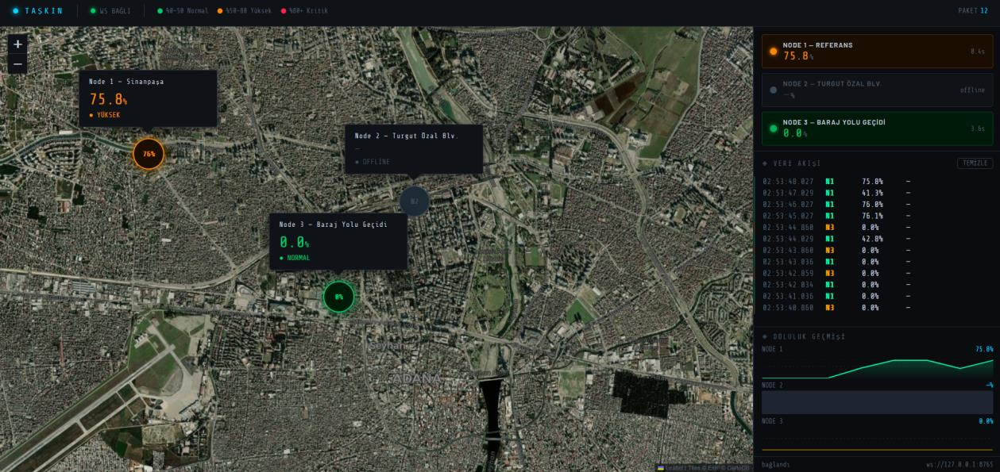

| Tarih | Düğüm | Konum | Yağış |
|---|---|---|---|
| 9 Şubat Sabah | Düğüm 1 | Seyhan — Barajyolu Alt Geçidi | ~1,5 mm |
| 9 Şubat Öğleden Sonra | Düğüm 1 | Seyhan — Barajyolu Alt Geçidi | ~4,2 mm |
| 10 Şubat | Düğüm 2 | Çukurova — Turgut Özal Bulvarı | ~5,8 mm |
| 11 Şubat | Düğüm 3 | Yüreğir — Sinanpaşa (Ref.) | ~9,5 mm |

TRİ'nin beş parametresi (O ortalama, M maks, E %80 üzeri süre, F %80 aşım sayısı, A tepe artış hızı), `analysis/tri_score.py` ile `data/samples/` üzerinde hesaplanmıştır:

| Düğüm | O ort. (%) | M maks (%) | Std. Sapma | E >%80 (sn) | F aşım | A artış (%/dk) |
|---|---|---|---|---|---|---|
| Düğüm 1 — Barajyolu | 62 | 94 | 11,4 | 168 | 7 | 39 |
| Düğüm 2 — Turgut Özal | 43 | 82 | 8,4 | 54 | 3 | 19 |
| Düğüm 3 — Sinanpaşa (Ref.) | 18 | 29 | 5,9 | 0 | 0 | 4 |

Barajyolu yalnızca en çok dolan nokta değil — varyansı da en yüksek, %80 aşım sayısı en fazla ve doluluk artış hızı Turgut Özal'dan ~%82 daha yüksek.

**TRİ Skorları** (karma normalizasyon, eşit ağırlık — `analysis/tri_score.py` çıktısı):

| Düğüm | TRİ | Risk Seviyesi |
|---|---|---|
| Düğüm 1 — Barajyolu | **91** | 🔴 Kritik |
| Düğüm 2 — Turgut Özal | **49** | 🟡 Orta |
| Düğüm 3 — Sinanpaşa (Ref.) | **9** | 🟢 Düşük |

> **Yöntem & duyarlılık (AR-GE).** Üç nokta üç ayrı risk sınıfına düşüyor. Başlangıçta her parametreyi min-maks ile normalize ettik; ancak tek bir normalizasyon, zaten 0–100% fiziksel ölçekteki ortalama ve maksimum için uygun değil — bu yüzden yukarıdaki karma şemaya geçtik. Duyarlılık kontrolü sağlamlığı doğruluyor: saf min-maks'ta (`--method minmax`) skorlar kayıyor ama Barajyolu net şekilde #1 kalıyor ve genel sıralama değişmiyor — eşit ağırlık tercihi bu nedenle savunulabilir.

Düğüm başına oturum boyunca doluluk (yeniden üretmek için: `python analysis/tri_score.py --chart`):

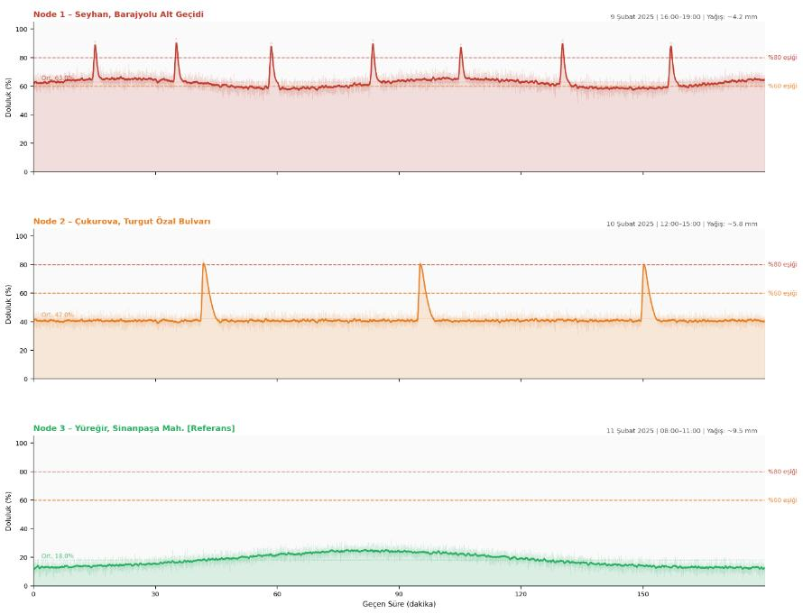

---

## 11. Sınırlılıklar ve İyileştirme Önerileri

### Batarya Ömrü

Saha testleri aşamasında sistemin kararlılığını ve veri sürekliliğini ölçmek amacıyla cihaz **Sürekli Açık (Always-On)** modunda çalıştırılmıştır.

| Bileşen | Durum | Akım Tüketimi (Ort.) |
|---|---|---|
| ESP32-DevKit V4 | Aktif (WiFi açık) | ~70–90 mA |
| JSN-SR04T | Sürekli ölçüm | ~15 mA |
| MT3608 Regülatör | Kayıp | ~5–10 mA |
| **Toplam** | **Sürekli Aktif** | **~90–115 mA** |

**Test Sonucu:** 3,7V 1800 mAh Li-Po batarya ve MT3608 yükseltici modül ile yapılan testlerde, kesintisiz veri gönderimi ve kaydı altında ortalama **13-14 saat çalışma süresi** gözlemlenmiştir.

> **Not:** Pil ömrünü aylara yaymak için yazılımsal olarak **Derin Uyku (Deep Sleep)** optimizasyonu bir sonraki güncelleme aşaması olarak planlanmaktadır. ESP32'nin ölçümler arasında uyku moduna alınmasıyla tahmini tüketim ~10 mA'e düşecek; bu da 60–80 saatlik sürekli çalışmayı mümkün kılacaktır.

### Mevcut Zayıf Noktalar

| Zayıflık | Etkisi |
|---|---|
| Köpük/türbülanstan ultrasonik yansıma | JSN-SR04T ile bile yüzey türbülansı yankıyı saçabilir (5 örnek medyanı ile hafifletilir) |
| NODE_ID yükleme sırasında sabit kodlanmıştır | Birden fazla düğüm için ayrı Arduino yüklemesi gerekir |
| Gerçek zamanlı saat (RTC) yoktur | CSV zaman damgaları `millis()` — başlangıçtan geçen süre, duvar saati değil |
| Tek atlama ESP-NOW | Tüm düğümler merkezin ~200 m yakınında olmalıdır |
| Yalnızca 3 günlük saha testi | Mevsimsel değişkenlik belirsizdir |
| Yağış ölçer entegrasyonu yoktur | Doluluk artış hızı kesin yağış verisiyle ilişkilendirilememektedir |
| Pano için bilgisayar gereklidir | Merkez, çalışan bir `server.py`'ye USB ile bağlı olmalıdır |

### Önerilen Geliştirmeler

1. JSN-SR04T'nin köpük/türbülans bağışıklığı için radar / MaxBotix MB7389 sensöre yükseltilmesi
2. Mutlak zaman damgaları için merkeze DS3231 RTC modülü eklenmesi
3. Çok günlük batarya çalışması için ESP32 Derin Uyku ile 1 Hz uyandırma döngüsü uygulanması
4. Kalıcı saha kurulumu için güneş paneli + şarj kontrolcüsü eklenmesi
5. Yağış korelasyonu için MGM hava durumu API'si entegrasyonu
6. Saha testinin tam yağış mevsimine (Adana'da Ekim–Mart) genişletilmesi
7. Yerel bilgisayara bağımlılığı ortadan kaldırmak için MQTT/HTTP bulut yüklemesi eklenmesi

---

## 12. Sonuç

TAŞKIN, düğüm başına 10 dolar altı maliyetle altyapı risk önceliklendirmesine uygun, istatistiksel açıdan farklılaştırılmış çok noktalı doluluk verisi üretebildiğini göstermektedir. Bileşik TRİ metriği, konumları yalnızca anlık tepe değerleriyle değil; birden fazla parametre üzerinden sıralamayı mümkün kılmaktadır.

Sistem, Düğüm 1'i (Barajyolu alt geçidi) tüm ölçülen parametreler açısından en yüksek riskli konum olarak doğru biçimde belirlemiştir — bu sonuç, bilinen yerel taşkın geçmişiyle örtüşmektedir. Referans düğüm olan Düğüm 3 (Sinanpaşa), tüm oturumlarda kararlı ve düşük doluluk sergileyerek karşılaştırmalı ölçüm tasarımını doğrulamıştır.

Temel kısıt, yalnızca 3 günlük saha penceresidir. Sistemin planlama açısından değeri, veri süresiyle orantılı olarak artar — anlamlı eğilim çıkarımı ve altyapı önceliklendirme önerileri için en az 3 aylık sürekli veri gereklidir.

---

## Lisans

[MIT Lisansı](LICENSE) — Telif Hakkı (c) 2026 TAŞKIN Projesi

---

<div align="center">
<sub>TAŞKIN Projesi · Adana Pilot Sahası · 2026</sub>
</div>
